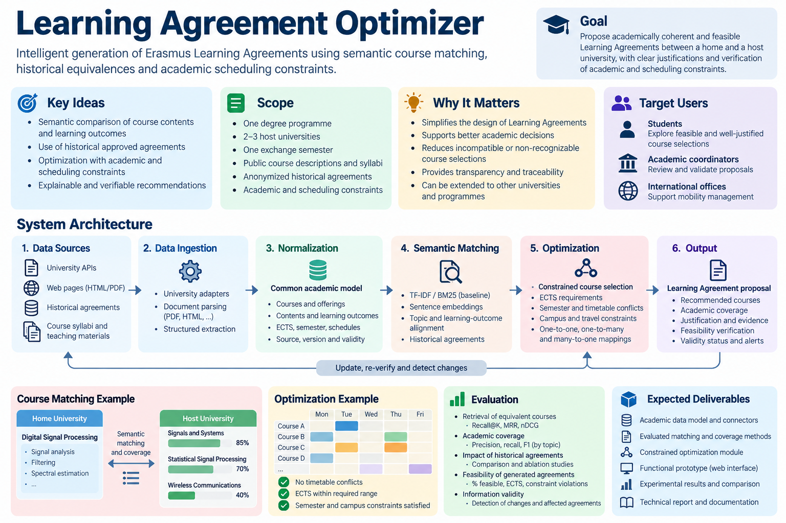

# Learning Agreement Optimizer

**Intelligent generation and optimization of academic Learning Agreements**

A system for recommending academically coherent and feasible Learning Agreements between home and host universities, combining semantic course matching, curriculum coverage, historical equivalences, and academic scheduling constraints.

> **Project status:** Final Degree Project (TFG) — Initial development.
>
> **Scope:** Academic research and proof of concept. Generated Learning Agreements are recommendations subject to validation and approval by the corresponding academic authorities.

---

## Project Overview



*Overview of the proposed system, including academic data ingestion, semantic course matching, constrained optimization, and Learning Agreement validation.*


## 1. Objectives

The main objective is to design, implement, and evaluate a prototype capable of automatically proposing **academically coherent and feasible Learning Agreements** for international exchange students.

The system addresses three complementary problems:

1. **Academic equivalence:** Identify courses at the host university whose combined contents and learning outcomes adequately cover those of the home university.
2. **Historical knowledge:** Exploit previously approved Learning Agreements to improve recommendations, accounting for possible changes in course contents.
3. **Feasibility:** Verify that the proposed combination satisfies academic and logistical constraints, including ECTS credits, semesters, timetables, groups, and campus locations.

The system must provide **explainable recommendations**, identifying the academic evidence supporting each equivalence, any missing contents, and potential scheduling conflicts.

### Research questions

The project will investigate:

- How accurately can semantic similarity models identify equivalent university courses?
- Does topic-level and learning-outcome alignment improve equivalence assessment compared with whole-document similarity?
- Can historical Learning Agreements improve course recommendations?
- How can academic coverage and scheduling constraints be jointly optimized?
- How can changes in academic information be detected and their impact on existing recommendations assessed?

---

## 2. Scope

The initial implementation will focus on:

- One degree programme at the home university.
- Two or three host universities.
- One exchange semester.
- Publicly available course descriptions, syllabi, and teaching materials.
- Previously approved Learning Agreements, when available and appropriately anonymized.
- Academic and scheduling constraints.

The project does not aim to develop a universal university web scraper or automate the administrative approval of Learning Agreements.

The emphasis is on **semantic curriculum matching, constrained optimization, and experimental evaluation**.

---

## 3. Methodology

### 3.1. Literature review and data collection

Review existing approaches to:

- Course equivalency and credit transfer.
- Syllabus and curriculum matching.
- Semantic textual similarity.
- Learning-outcome alignment.
- Content-based recommendation systems.
- Constrained course selection and scheduling.

Collect course descriptions, syllabi, learning outcomes, teaching materials, academic schedules, and historical Learning Agreements.

Data acquisition should prioritize official APIs and structured downloads. Web scraping may be used for publicly accessible information when necessary and permitted.

### 3.2. Academic data normalization

Define a common data model to represent academic information independently of its university of origin.

The model should include:

- University and degree programme.
- Course identification and academic credits.
- Course description and syllabus.
- Topics, competences, and learning outcomes.
- Academic year and course version.
- Semester, teaching groups, schedules, campus, and language.
- Source documents and provenance metadata.

A fundamental distinction must be maintained between:

- **Course:** Academic contents, competences, and learning outcomes.
- **Course offering:** A particular implementation of the course in a given academic year, semester, and teaching group.

#### Data validity and versioning

Academic information may change over time. The system must record:

- Source and retrieval date.
- Last verification date.
- Academic validity period.
- Document or content version.
- Verification status: confirmed, provisional, or unknown.

Previous versions should be preserved to maintain traceability and determine whether historical equivalences remain applicable.

### 3.3. Semantic course matching

Develop and compare several approaches.

**Baseline methods:**

- TF-IDF and cosine similarity.
- BM25.
- Sentence embeddings applied to complete course descriptions.

**Advanced methods:**

- Topic-level semantic matching.
- Learning-outcome alignment.
- Comparison of detailed teaching materials when available.
- Cross-encoder reranking.
- Historical equivalence-based recommendation.

A key objective is to distinguish **semantic similarity from academic coverage**.

Two courses may be semantically similar without covering the same essential contents.

Academic coverage should therefore be evaluated directionally:

$begin:math:display$
C\(A\,B\) \\neq C\(B\,A\)
$end:math:display$

where $begin:math:text$C\(A\,B\)$end:math:text$ represents the extent to which course B covers the contents of course A.

The system should identify missing topics and support coverage through combinations of several host-university courses, avoiding double-counting overlapping contents.

### 3.4. Learning Agreement optimization

Once candidate courses have been identified, formulate a constrained optimization problem.

The optimization should consider:

- Academic content coverage.
- ECTS requirements.
- Semester availability.
- Timetable conflicts.
- Teaching groups.
- Campus compatibility and travel time.
- Institutional recognition rules.

The system should support one-to-one, one-to-many, and many-to-one course equivalences when academically appropriate.

Candidate techniques include Mixed-Integer Linear Programming (MILP) and Constraint Programming (CP-SAT).

### 3.5. Explainability and information validity

Each proposed Learning Agreement should include:

- Recommended host-university courses.
- Corresponding home-university courses.
- Academic coverage scores.
- Supporting evidence and historical precedents.
- Missing or insufficiently covered contents.
- Verified constraints and unresolved uncertainties.
- Information validity status.

Changes in course descriptions, academic schedules, or semester availability should trigger reassessment of affected recommendations.

---

## 4. System Architecture

```text
                    DATA SOURCES
                         |
       +-----------------+-----------------+
       |                 |                 |
  University APIs    HTML / PDF      Historical LAs
       |                 |                 |
       +-----------------+-----------------+
                         |
                         v
                 DATA INGESTION
              University adapters
                         |
                         v
              DATA NORMALIZATION
              Common academic model
                         |
                         v
             VERSIONED DATA STORAGE
          Sources / Metadata / History
                         |
              +----------+----------+
              |                     |
              v                     v
       SEMANTIC MATCHING      ACADEMIC CONSTRAINTS
       - TF-IDF / BM25        - ECTS
       - Embeddings           - Semesters
       - Topic alignment      - Timetables
       - Historical LAs       - Campus / Groups
              |                     |
              +----------+----------+
                         |
                         v
               AGREEMENT OPTIMIZER
                 MILP / CP-SAT
                         |
                         v
                LEARNING AGREEMENT
               - Course equivalences
               - Academic coverage
               - Feasibility
               - Supporting evidence
               - Validity status
```

The architecture should separate data acquisition, academic representation, semantic matching, and optimization.

University-specific adapters must produce data conforming to the common academic model.

---

## 5. Repository Structure

The following structure is proposed as a starting point and may evolve during development.

```text
learning-agreement-optimizer/
|
|-- README.md
|-- LICENSE
|-- .gitignore
|-- requirements.txt
|
|-- docs/
|   |-- architecture.md
|   |-- data_model.md
|   |-- methodology.md
|   |-- references.md
|   `-- experiments.md
|
|-- data/
|   |-- raw/
|   |-- normalized/
|   |-- historical/
|   `-- examples/
|
|-- src/
|   |-- ingestion/
|   |   |-- adapters/
|   |   |-- parsers/
|   |   `-- extractors/
|   |
|   |-- models/
|   |   |-- academic.py
|   |   `-- schemas.py
|   |
|   |-- matching/
|   |   |-- baseline.py
|   |   |-- embeddings.py
|   |   |-- coverage.py
|   |   `-- historical.py
|   |
|   |-- optimization/
|   |   |-- constraints.py
|   |   `-- optimizer.py
|   |
|   |-- validation/
|   |   |-- feasibility.py
|   |   |-- versioning.py
|   |   `-- provenance.py
|   |
|   `-- app/
|       `-- main.py
|
|-- experiments/
|   |-- retrieval/
|   |-- coverage/
|   |-- optimization/
|   `-- ablation/
|
|-- notebooks/
|
`-- tests/
    |-- test_ingestion.py
    |-- test_matching.py
    |-- test_optimization.py
    `-- test_validation.py
```

### Directory responsibilities

| Directory | Purpose |
|---|---|
| `docs/` | Technical documentation, methodology, and references |
| `data/raw/` | Original downloaded academic documents |
| `data/normalized/` | Structured academic information |
| `data/historical/` | Authorized and anonymized historical agreements |
| `data/examples/` | Synthetic or public demonstration datasets |
| `src/ingestion/` | University-specific data acquisition and parsing |
| `src/models/` | Common academic data model and validation schemas |
| `src/matching/` | Semantic similarity and academic coverage |
| `src/optimization/` | Learning Agreement optimization |
| `src/validation/` | Feasibility, provenance, and version control |
| `src/app/` | Application interface |
| `experiments/` | Experimental configurations and results |
| `notebooks/` | Exploratory analysis and prototyping |
| `tests/` | Automated tests |

**Note:** The directory structure represents the intended architecture. Components should be implemented progressively rather than created as empty placeholders.

Sensitive, copyrighted, or access-restricted academic materials must not be committed to the public repository. Reproducible examples should use public or synthetic datasets.

---

## 6. Technology Stack

The following tools are candidates rather than mandatory dependencies.

| Component | Technologies |
|---|---|
| Programming language | Python |
| Data acquisition | Requests, Beautiful Soup, PyMuPDF, Playwright |
| Data validation | Pydantic, JSON Schema |
| Database | SQLite or PostgreSQL |
| Text processing | scikit-learn, Sentence Transformers |
| Semantic retrieval | Embeddings, Cross-Encoders, optionally FAISS |
| Optimization | Google OR-Tools (CP-SAT), PuLP (MILP) |
| Application | Streamlit or FastAPI |
| Testing | pytest |
| Experiment tracking | Structured CSV/JSON results; MLflow optional |

LLMs may optionally support structured information extraction and evidence-based explanations.

They should not be treated as the sole authority for academic equivalence decisions.

---

## 7. Experimental Evaluation

The project must include a reproducible evaluation comparing alternative methods.

### 7.1. Course retrieval

Evaluate whether the system retrieves academically relevant courses.

**Metrics:**

- Recall@K.
- Mean Reciprocal Rank (MRR).
- nDCG@K.

Historical agreements reserved for testing may provide positive examples, but the absence of an equivalence in previous agreements must not automatically be interpreted as a negative example.

### 7.2. Academic coverage

Evaluate the identification of equivalent and missing contents against expert annotations.

**Metrics:**

- Precision, recall, and F1 at topic level.
- Weighted academic coverage.
- Accuracy of missing-content identification.

Compare whole-document similarity with topic-level alignment.

### 7.3. Historical knowledge contribution

Compare recommendations:

1. Without historical equivalences.
2. With historical equivalences.
3. With historical equivalences and detailed content alignment.

Quantify the contribution of each component through ablation experiments.

### 7.4. Learning Agreement feasibility

Evaluate the optimization process using academic and scheduling constraints.

**Metrics:**

- Percentage of feasible agreements.
- Academic coverage achieved.
- ECTS requirements satisfied.
- Number of constraint violations.
- Computational time.
- Number of unresolved constraints due to missing information.

Compare constrained and unconstrained recommendations.

### 7.5. Information validity

Introduce controlled modifications to course descriptions, schedules, or semester availability.

Evaluate:

- Detection of relevant changes.
- Identification of affected agreements.
- Correct invalidation or reassessment of recommendations.
- False feasibility declarations caused by outdated information.

### 7.6. Evaluation protocol

The experimental design should:

- Separate training, validation, and test data.
- Avoid leakage between historical agreements.
- Consider chronological splits by academic year.
- Include expert assessment of a representative sample.
- Report cases where no feasible agreement exists.
- Document limitations and uncertainty.

---

## 8. Development Plan

The project can be organized into six phases.

| Phase | Activities | Expected result |
|---|---|---|
| 1. Research | Literature review and dataset selection | State of the art and evaluation dataset |
| 2. Data | University adapters, normalization, and versioning | Common academic database |
| 3. Matching | Baselines, embeddings, and content coverage | Evaluated equivalence recommendation engine |
| 4. Optimization | Academic and scheduling constraints | Feasible Learning Agreement generator |
| 5. Validation | Explanations, provenance, and change detection | Traceable and verifiable recommendations |
| 6. Evaluation | Experiments, ablation studies, and demonstration | Experimental results and final prototype |

The initial priority is to establish a reliable dataset and evaluation protocol before developing advanced recommendation methods.

---

## 9. References

### Semantic similarity and information retrieval

1. Reimers, N., & Gurevych, I. (2019).  
   *Sentence-BERT: Sentence Embeddings using Siamese BERT-Networks.*  
   EMNLP-IJCNLP.  
   https://arxiv.org/abs/1908.10084

2. Karpukhin, V., et al. (2020).  
   *Dense Passage Retrieval for Open-Domain Question Answering.*  
   EMNLP.  
   https://arxiv.org/abs/2004.04906

3. Khattab, O., & Zaharia, M. (2020).  
   *ColBERT: Efficient and Effective Passage Search via Contextualized Late Interaction over BERT.*  
   SIGIR.  
   https://arxiv.org/abs/2004.12832

### Content alignment and optimization

4. Cuturi, M. (2013).  
   *Sinkhorn Distances: Lightspeed Computation of Optimal Transport.*  
   NeurIPS.  
   https://arxiv.org/abs/1306.0895

### Academic standards and interoperability

5. European Commission.  
   *ECTS Users' Guide (2015).*  
   European Credit Transfer and Accumulation System.

6. European Commission.  
   *European Learning Model (ELM).*  
   European framework for representing educational information.

7. Erasmus Without Paper (EWP).  
   Digital interoperability framework for Erasmus+ student mobility.

### Further literature review

The formal literature review must identify and classify publications specifically addressing:

- Automatic course equivalency.
- University syllabus matching.
- Curriculum mapping.
- Learning-outcome alignment.
- Academic credit transfer.
- Constrained course recommendation.

The methodological references above provide relevant algorithms but do not, by themselves, solve the complete Learning Agreement generation problem.

---

## 10. Expected Deliverables

The project should produce:

1. A documented academic data model with provenance and version control.
2. Data acquisition adapters for selected universities.
3. A reproducible dataset for course equivalence evaluation.
4. A semantic matching and academic coverage engine.
5. A constrained Learning Agreement optimizer.
6. An explanation and feasibility validation mechanism.
7. Experimental comparisons against baseline methods.
8. A functional prototype demonstrating the complete workflow.
9. A final technical report documenting methods, results, and limitations.

---

## 11. Project Limitations

The system is intended as an academic decision-support tool.

It does not replace institutional procedures for course recognition or Learning Agreement approval.

Recommendations depend on the completeness, accuracy, and validity of the available academic information.

Historical agreements provide useful evidence but do not guarantee that an equivalence remains valid.

When essential information is missing or outdated, the system must explicitly indicate that feasibility cannot be fully verified.

---

## License

This project is distributed under the MIT License. See [LICENSE](LICENSE) for details.
